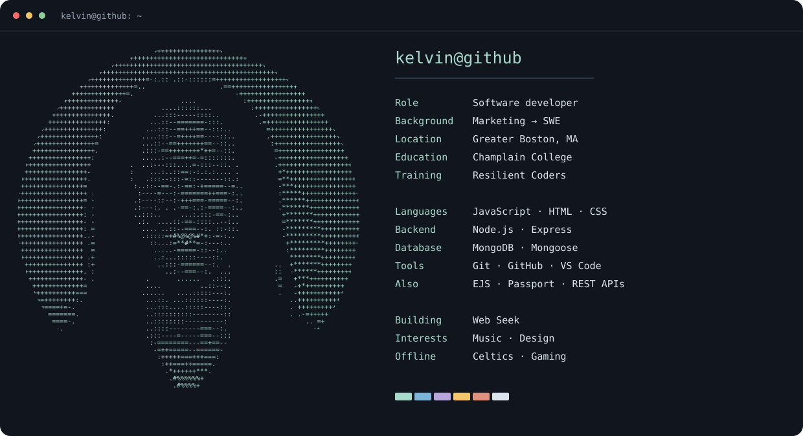

# Hey, I'm Kelvin 👋🏾

I'm a **software engineer in Greater Boston**. I build full-stack web apps that are useful, thoughtful, and easy to use.

## 🛠️ What I build with

  
  
  
  
  
  
  
  
  
  

**JavaScript · HTML · CSS · Node.js · Express · MongoDB · Mongoose · Git · GitHub · VS Code**

I also work with **EJS, Passport, and REST APIs**. Right now, I'm building **Web Seek**, a prospecting tool for freelance developers.

## 🎧 Beyond the keyboard

Music is always in the rotation, whether I'm discovering something new or revisiting a favorite. I'm a Celtics fan, a gamer, and into design and creative technology. When I want a change of pace, I like getting outside for a hike.

## 🤝 Let's connect

**Let's build something useful.**

🌐 [Portfolio](https://kelvin.staticdomains.app) · 💼 [LinkedIn](https://www.linkedin.com/in/kelvin-imalenowa) · 📅 [Book a chat](https://calendly.com/imalenowa)
